<p align="center">
  
</p>

<p align="center"><strong>Passerelle EnOcean ↔ MQTT multi-marques</strong> · <em>Multi-brand EnOcean ↔ MQTT gateway</em></p>

<p align="center"><a href="#français">Français</a> · <a href="#english">English</a></p>

---

> 🧪 **Version bêta (0.2.0b21)** — à tester, pas encore pour une installation en production.
> **Beta release** — for testing, not yet for production use.

<p align="center">
  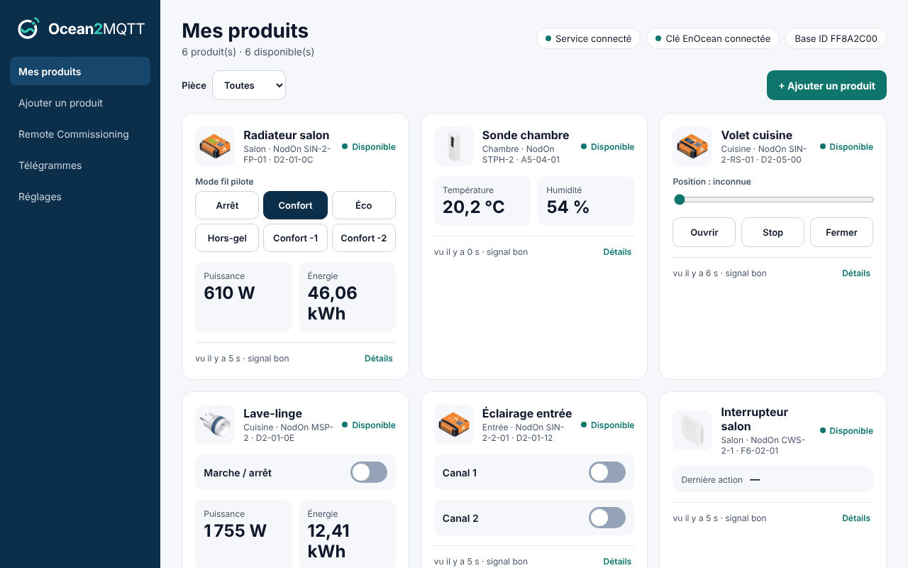
</p>

## Français

Ocean2MQTT fait pour EnOcean ce que Zigbee2MQTT fait pour Zigbee : une clé USB, une interface web, et tous vos produits EnOcean publiés sur MQTT, quelle que soit leur marque. Il fonctionne avec Home Assistant (découverte automatique), Jeedom, Node-RED, openHAB et tout système qui parle MQTT.

Ocean2MQTT s'appuie sur le code de [NodOcean for HA](https://github.com/eHomeLabs/NodOcean-for-HA), validé sur produits réels.

### Fonctionnalités

**Ajouter un produit**
- **Bibliothèque de produits** : recherche par référence, nom ou EEP, filtres par marque et par type. Chaque fiche affiche la photo, le profil EEP, ce que vous obtiendrez et la procédure d'appairage pas à pas.
- **Appairage guidé** : Ocean2MQTT écoute 60 s avec un compte à rebours et répond automatiquement selon le produit (UTE bidirectionnel, 4BS, 4BS bidirectionnel, 1BS, premier appui RPS). Vous nommez ensuite le produit, choisissez sa pièce et voyez son topic MQTT.
- **Mode générique** pour les produits absents de la bibliothèque : vous choisissez le profil EEP et obtenez ses fonctions de base. Pour un actionneur D2-01, le type exact et le nombre de canaux sont lus dans sa demande d'appairage.
- **Suggestion automatique** : quand un produit inconnu envoie sa demande d'appairage, Ocean2MQTT propose les fiches qui lui ressemblent (code fabricant + EEP). Les capteurs et interrupteurs déjà entendus s'ajoutent en un clic.
- **Niveaux de support** affichés sur chaque fiche : *Validé* (testé sur produit réel), *Communauté* (pas encore testé), *Générique*.

**Utiliser ses produits**
- **Mes produits** : une carte par produit avec ses commandes (marche / arrêt, canaux, mode fil pilote, volet roulant, consigne de la tête thermostatique) et ses mesures (température, humidité, puissance, énergie, luminosité, CO2, COV, ouverture, fuite d'eau, poignée…), la dernière action des boutons, la disponibilité et la qualité du signal. Filtre par pièce.
- **Puissance et énergie** : le rapport automatique des mesures est réglé sur les produits avec mesure, et les actionneurs sont interrogés toutes les 60 s.
- **Fiche détaillée** de chaque produit : onglets Contrôle, Réglages, Remote Commissioning, Télégrammes et Informations (identifiant, topic, EEP, notice, renommer, retirer).

**Réglages et Remote Commissioning**
- **Réglages des produits** : LED, bouton local, télécommandes appairées en direct, détection de coupure, état au retour du courant, extinction automatique ou retardée par canal, type d'interrupteur filaire, temps de course et calibration du volet, répéteur, remise à zéro de l'énergie. Réglages appliqués par Ocean2MQTT : nombre de boutons, corrections de température et d'humidité, délai d'indisponibilité.
- **Remote Commissioning** (ReMan / ReCom) des produits qui le gèrent. **Code de sécurité choisi à l'appairage** : *automatique* (calculé à partir de l'ID du produit et d'un secret propre à l'installation : toujours le même, impossible à deviner, retrouvable avec la sauvegarde), *saisi* (QR code 11Z… ou code au choix) ou *aucun* (réglages à distance seulement juste après une mise sous tension). **Détection du code** d'un produit qui en a déjà un (code enregistré, code automatique, code saisi), test Ping, lecture / ajout / suppression des télécommandes appairées, lecture des paramètres du volet, journal des opérations.
- **Sécurité du Remote Commissioning** : le protocole EnOcean Remote Management n'est pas chiffré, le code d'un produit passe en clair à la radio lors d'un déverrouillage. Ocean2MQTT ne l'envoie que sur action de l'utilisateur, **demande confirmation avant chaque envoi**, garde le déverrouillage 5 minutes (durée des produits, renouvelé au bout de 4), ne montre jamais le code et le masque dans les journaux. Le Remote Commissioning peut être **désactivé complètement** (`recom.enabled: false` ou option de l'add-on) : aucune commande n'est alors envoyée.

**Migration et sauvegarde**
- **Clé EnOcean HS ou remplacée** : Ocean2MQTT détecte la nouvelle clé et propose d'y écrire le **Base ID** de l'ancienne, pour que les actionneurs la reconnaissent sans réappairage.
- **Serveur MQTT et topics modifiables dans l'interface**, avec test de la connexion.
- **Reprise depuis NodOcean for HA, sans réappairer** : l'add-on détecte NodOcean dans Home Assistant et reprend produits, noms, pièces, adresses d'émission et codes Remote Commissioning. Un assistant rappelle de désactiver NodOcean (une clé ne sert qu'à un seul logiciel).
- **Fichier d'export NodOcean** (bouton « Exporter pour Ocean2MQTT » de NodOcean for HA 0.8.6) pour Ocean2MQTT en Docker ou sur une autre machine.
- **Autre clé EnOcean** : reprendre seulement les capteurs (les actionneurs gardent nom, pièce et réglages et sont signalés « à réappairer »), ou partir d'une installation vierge.
- **Produits génériques de NodOcean** : à la reprise, choix de la fiche du vrai produit (même profil EEP). **Changer de fiche** reste possible ensuite depuis la fiche d'un produit, sans réappairage.
- **Changement de clé détecté** automatiquement, avec un bouton « Réappairer » sur chaque actionneur concerné.
- **Sauvegarde / restauration** de tous les produits appairés dans un fichier JSON.

**Diagnostic**
- **Journal radio** en direct : télégrammes reçus et émis, filtres par émetteur et par RORG, pause, export CSV.
- **Émetteurs inconnus** : liste des produits entendus mais pas appairés, avec leur EEP quand il est connu.

**Intégration**
- **Pont MQTT** avec topics à la Zigbee2MQTT et **découverte automatique Home Assistant** : chaque commande, mesure et réglage devient une entité (les réglages en entités de configuration).
- **Interface web** en **français et en anglais**, utilisable sur téléphone, mise à jour en direct par WebSocket.
- **Add-on Home Assistant** (accès depuis la barre latérale), **image Docker** amd64 / arm64, ou paquet **Python**.
- **Contributions ouvertes** : un produit = une fiche YAML + une photo, sans écrire de code.

### Captures d'écran

| Ajouter un produit | Appairage |
| --- | --- |
| 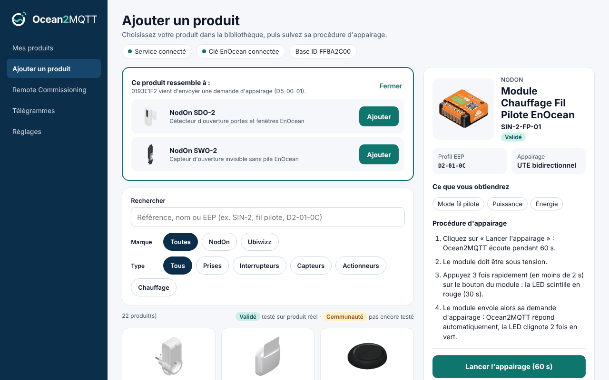 | 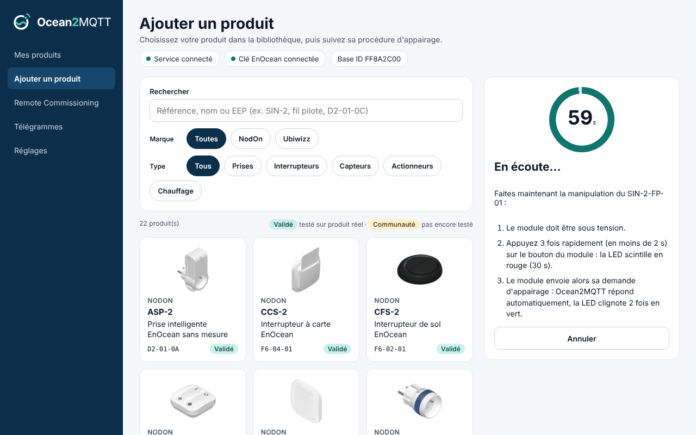 |
| **Suggestion automatique** | **Produit appairé** |
| 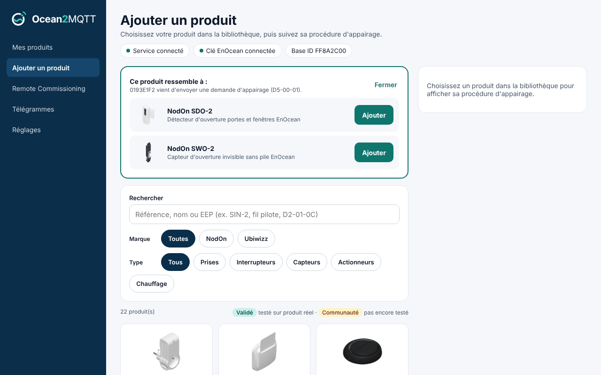 | 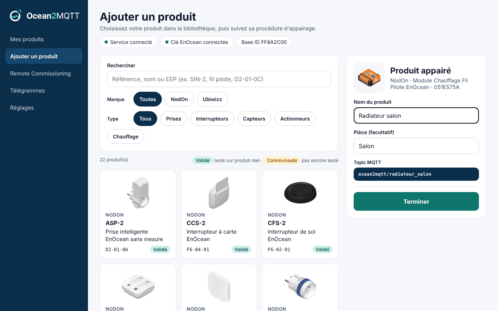 |
| **Réglages** | **Remote Commissioning** |
| 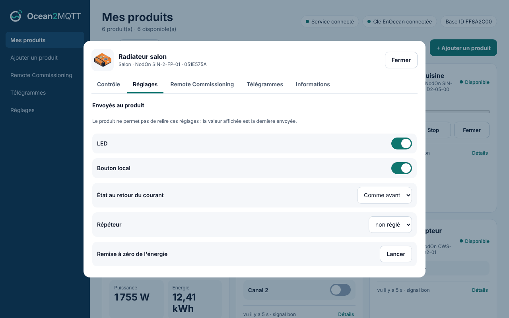 | 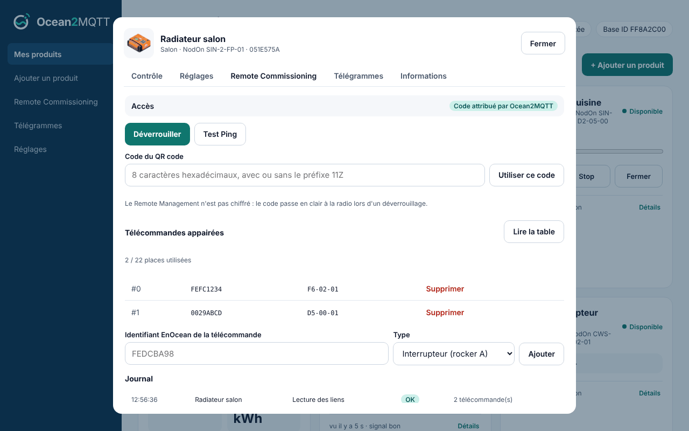 |
| **Télégrammes** | **Sur téléphone** |
| 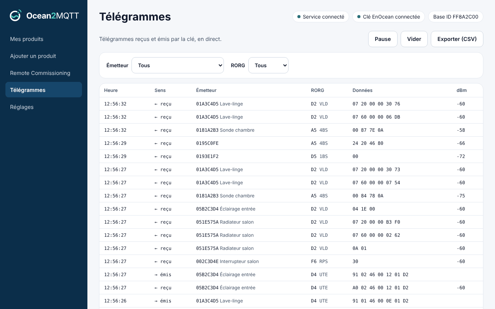 | 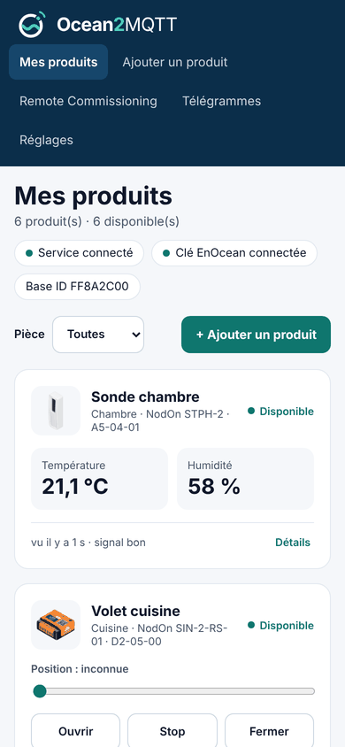 |

### Produits

**[Catalogue en ligne des produits compatibles](https://ehomelabs.github.io/Ocean2MQTT/)** · **[Proposer un nouveau produit EnOcean](https://github.com/eHomeLabs/Ocean2MQTT/issues/new?template=nouveau-produit.yml)** (fiche créée automatiquement après validation)

Clés prises en charge : clés ESP3 en USB ou série (USB300, USB500, TCM310 / EnOcean Pi), 868 MHz.

| Marque | Produits | Support |
| --- | --- | --- |
| NodOn | ASP-2, CCS-2, CFS-2, CRC-2, CWS-2-1, MSP-2, PIR-2, SDO-2, SIN-2-1-01, SIN-2-2-01, SIN-2-FP-01, SIN-2-RS-01, STP-2, STPH-2, SWO-2, TSB-2 | Validé |
| Ubiwizz | UBID1501S (prise avec mesure) | Validé |
| Ubiwizz | MICITRV004 (tête thermostatique), SERFAH60 (luminosité), UBI10804192 (poignée), UBILD023 (CO2 / COV), UBILD001 (détecteur de fumée), UBID1220211 (fuite d'eau) | Communauté |
| Toutes | Mode générique : F6-02-01, F6-04-01, F6-05-01, F6-10-00, D5-00-01, A5-02-05, A5-04-01, A5-06-01, A5-07-03, A5-09-04, A5-09-05, A5-20-01, D2-01-xx, D2-05-00 | Générique |

Votre produit n'est pas dans la liste ? Essayez le mode générique, puis proposez sa fiche (voir *Contribuer*).

### Vous utilisiez NodOcean for HA ?

1. Installez Ocean2MQTT (add-on) en gardant **la même clé EnOcean**.
2. **Désactivez NodOcean for HA** (Paramètres → Appareils et services → NodOcean for HA → ⋮ → Désactiver), puis redémarrez l'add-on.
3. Sur « Mes produits », cliquez sur **Reprendre mes produits** : rien à réappairer.

Ocean2MQTT en Docker : dans NodOcean for HA, appuyez sur **Exporter pour Ocean2MQTT** (appareil « Clé EnOcean »), puis importez le fichier `nodocean_export_ocean2mqtt.json` dans **Réglages → Migration et sauvegarde**. Les entités MQTT d'Ocean2MQTT remplacent celles de NodOcean : pensez à vos automatisations.

### Installation

**Home Assistant OS / Supervised** : add-on Ocean2MQTT.

[](https://my.home-assistant.io/redirect/supervisor_add_addon_repository/?repository_url=https%3A%2F%2Fgithub.com%2FeHomeLabs%2Fhassio-ocean2mqtt)

Cliquez sur le bouton (ou **Paramètres → Applications → Boutique → ⋮ → Dépôts** et ajoutez `https://github.com/eHomeLabs/hassio-ocean2mqtt`), installez **Ocean2MQTT**, choisissez la clé EnOcean dans **Configuration** et démarrez. L'add-on utilise automatiquement Mosquitto et s'ouvre depuis la barre latérale. Guide complet : [wiki](https://github.com/eHomeLabs/Ocean2MQTT/wiki/Installation).

**Docker** (amd64, arm64 — Raspberry Pi 4 / 5 en 64 bits) :

```bash
docker run -d --name ocean2mqtt --restart unless-stopped \
  -v $(pwd)/data:/app/data -p 8080:8080 \
  --device /dev/ttyUSB0:/dev/ttyUSB0 \
  -e OCEAN2MQTT_MQTT_HOST=192.168.1.10 \
  ghcr.io/ehomelabs/ocean2mqtt:v0.2.0b21
```

Exemple avec Mosquitto : `docker-compose.example.yml`. Ouvrez ensuite `http://<machine>:8080`.

**Python** (3.12 ou plus) : `pip install .` puis `ocean2mqtt --data ./data --port /dev/ttyUSB0`.

**Sans clé EnOcean** (démo, clé et produits simulés) : `python tools/demo.py`, puis `http://127.0.0.1:8080`.

### Configuration

Le fichier `data/configuration.yaml` est créé au premier lancement. Chaque réglage peut aussi être passé en variable d'environnement `OCEAN2MQTT_<SECTION>_<CLÉ>` : `OCEAN2MQTT_SERIAL_PORT`, `OCEAN2MQTT_MQTT_HOST`, `OCEAN2MQTT_MQTT_USERNAME`, `OCEAN2MQTT_MQTT_PASSWORD`, `OCEAN2MQTT_FRONTEND_PASSWORD`…

Remote Commissioning : `recom.enabled` (`true` par défaut, `OCEAN2MQTT_RECOM_ENABLED=false` pour le désactiver).

Sécurité : l'interface web n'accepte que les adresses du réseau local (`frontend.allow_remote` pour changer) et peut être protégée par un mot de passe (`frontend.password`). Les produits appairés et leurs codes Remote Commissioning sont dans `data/devices.json`.

### MQTT

| Topic | Contenu |
| --- | --- |
| `ocean2mqtt/bridge/state` | `online` / `offline` |
| `ocean2mqtt/bridge/info`, `bridge/devices` | Passerelle, produits appairés (JSON) |
| `ocean2mqtt/bridge/request/<commande>` | Requêtes, réponse sur `bridge/response/<commande>` (voir ci-dessous) |
| `ocean2mqtt/bridge/event` | Appairage, nouveau produit, suggestion, opération Remote Commissioning |
| `ocean2mqtt/bridge/unknown` | Émetteurs entendus mais pas appairés |
| `ocean2mqtt/bridge/telegrams` | Télégrammes bruts (option `mqtt.telegrams`) |
| `ocean2mqtt/<produit>` | État JSON, réglages compris (ex. `{"mode": "eco", "power": 610, "energy": 46.06, "led": "ON"}`) |
| `ocean2mqtt/<produit>/availability` | `online` / `offline` |
| `ocean2mqtt/<produit>/set` | Commande ou réglage (ex. `ON`, `{"mode": "comfort"}`, `{"position": 50}`, `{"setpoint": 21}`, `{"led": "OFF"}`, `{"auto_off_l1": 300}`) |
| `ocean2mqtt/<produit>/get` | Relecture de l'état |
| `ocean2mqtt/<produit>/action` | Appuis de boutons |

Requêtes `bridge/request/…` :

| Requête | Rôle |
| --- | --- |
| `info`, `devices`, `library`, `library/generic` | Passerelle, produits appairés, bibliothèque, profils génériques |
| `pairing/start`, `pairing/stop` | Appairage (`{"product": "nodon/sin-2-fp-01"}` ou `{"product": "generique/a5-04-01"}`) |
| `migration/sources`, `migration/preview`, `migration/import`, `migration/dismiss` | Reprise depuis NodOcean ou un fichier (`{"mode": "same"}` même clé, `"new"` autre clé) |
| `backup/create` | Sauvegarde (restauration : `migration/import` avec `{"file": …}`) |
| `unknown`, `unknown/clear`, `device/add` | Émetteurs inconnus, ajout en un clic (`{"id": "0181A2B3", "product": "nodon/stph-2"}`) |
| `device/rename`, `device/remove`, `device/set`, `device/get` | Gestion et commande d'un produit |
| `device/compatible`, `device/change_product` | Fiches de même profil EEP, changement de fiche (`{"id": "…", "product": "nodon/cws-2-1"}`) |
| `device/settings`, `device/settings/set` | Réglages (`{"id": "…", "key": "led", "value": false}`) |
| `device/recom/<action>`, `recom/log` | Remote Commissioning : `status`, `ping`, `assign` (`mode`: `auto`, `custom`, `none`), `detect`, `unlock`, `code`, `links`, `links/add`, `links/delete`, `config` |
| `telegrams` | Derniers télégrammes |

La découverte automatique Home Assistant est activée par défaut (préfixe `homeassistant`).

### Contribuer

- **Ajouter un produit** : une fiche `produits/<marque>/<référence>.yaml` (format décrit dans `produits/schema.json`) et une photo PNG 400 × 400 px sur fond transparent. Contrôle : `python -m ocean2mqtt.library`.
- **Faire passer une fiche en Validé** : un rapport de test sur produit réel (appairage, commandes, mesures).
- **Code** : `pytest` pour les tests (clé USB300 simulée), `ruff check` pour le style ; interface : `cd frontend && npm ci && npm run build`.

| Dossier | Contenu |
| --- | --- |
| `src/ocean2mqtt/core/` | Cœur radio : clé ESP3, profils EEP, appairage, réglages, Remote Commissioning (sans Home Assistant ni MQTT) |
| `src/ocean2mqtt/library/` | Bibliothèque de produits et mode générique |
| `src/ocean2mqtt/` | Service : `app.py` (API commune), `mqtt.py` (pont MQTT + découverte HA), `web.py` (interface web + WebSocket) |
| `frontend/` | Interface web (TypeScript / React) |
| `produits/<marque>/` | Une fiche YAML + une photo par produit |
| `tests/`, `tools/` | Tests, démo sans matériel, outils |

## English

Ocean2MQTT does for EnOcean what Zigbee2MQTT does for Zigbee: one USB stick, a web interface, and all your EnOcean devices published to MQTT, whatever their brand. It works with Home Assistant (automatic discovery), Jeedom, Node-RED, openHAB and anything that speaks MQTT.

### Features

- **Device library**: search by reference, name or EEP, filter by brand and type; each sheet shows the picture, EEP profile, features and step-by-step pairing procedure.
- **Guided pairing**: 60 s listening window with a countdown; Ocean2MQTT answers automatically (bidirectional UTE, 4BS, bidirectional 4BS, 1BS, RPS first press), then you name the device and pick its room.
- **Generic mode** for devices not yet in the library (pick the EEP profile).
- **Automatic suggestion** when an unknown device sends its pairing request; sensors and switches already heard can be added in one click.
- **My devices**: controls (on/off, channels, pilot wire mode, roller shutter, valve setpoint) and measurements (temperature, humidity, power, energy, light, CO2, VOC, contact, water leak, window handle…), last button action, availability and signal quality.
- **Power and energy**: automatic measurement reporting is configured on metering devices, and actuators are polled every 60 s.
- **Device settings**: LED, local button, power-on state, auto off / delay off per channel, wired switch type, shutter travel time and calibration, repeater, energy reset, measurement offsets, unavailability timeout.
- **Remote Commissioning** (ReMan / ReCom): security code chosen at pairing — *automatic* (derived from the device ID and an installation secret: always the same, impossible to guess, recoverable from the backup), *entered* (QR code 11Z… or your own) or *none*; code detection for devices that already have one; ping, read / add / delete paired remotes, read shutter parameters, operation log. The protocol is not encrypted (the code is sent in clear when unlocking): Ocean2MQTT asks for confirmation before each send, and Remote Commissioning can be disabled completely (`recom.enabled: false`).
- **Live telegram log** with filters and CSV export; list of heard but unpaired devices.
- **Broken or replaced stick**: write the old **Base ID** into the new stick so actuators recognise it without re-pairing. **MQTT server and topics editable in the interface**, with a connection test.
- **Migration from NodOcean for HA without re-pairing** (same stick), NodOcean export file import, sensors-only import or fresh install with another stick, stick change detection with one-click re-pairing, backup and restore.
- **MQTT bridge** with Zigbee2MQTT-like topics and **Home Assistant discovery** (settings become configuration entities).
- **[Online catalogue of compatible devices](https://ehomelabs.github.io/Ocean2MQTT/)** and a **[Suggest a new EnOcean device](https://github.com/eHomeLabs/Ocean2MQTT/issues/new?template=nouveau-produit.yml)** form (sheet created automatically once approved), also from the **Add a device** page.
- **Web interface** in **French and English**, mobile-friendly, live updates over WebSocket.
- **Home Assistant add-on** (sidebar access), **Docker image** (amd64 / arm64) or **Python** package.
- **Open contributions**: one device = one YAML file + one picture, no code needed.

<p align="center">
  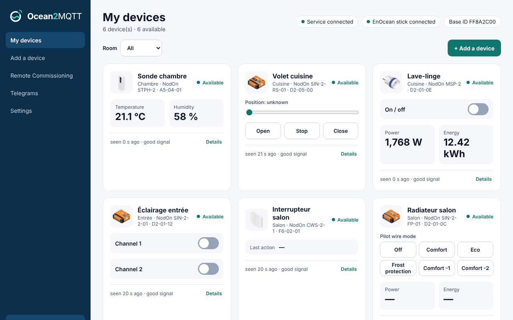
  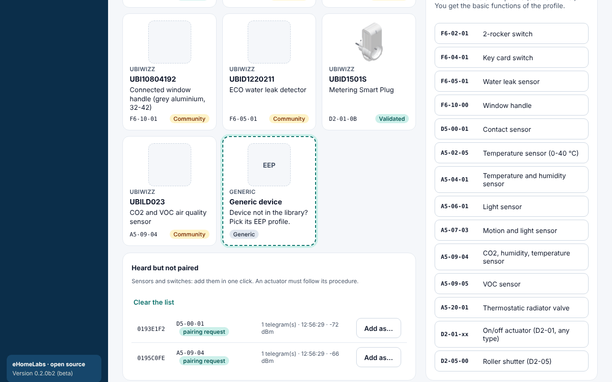
</p>

**Home Assistant OS / Supervised**: [](https://my.home-assistant.io/redirect/supervisor_add_addon_repository/?repository_url=https%3A%2F%2Fgithub.com%2FeHomeLabs%2Fhassio-ocean2mqtt) then install **Ocean2MQTT** from the store. Documentation: [wiki](https://github.com/eHomeLabs/Ocean2MQTT/wiki/Home-EN).

**Quick start**: see *Installation* above (Docker, Python, or `python tools/demo.py` for a demo without hardware). Configuration lives in `data/configuration.yaml`; every key can be overridden with `OCEAN2MQTT_<SECTION>_<KEY>` environment variables. MQTT topics and requests are listed in the *MQTT* section above.

## Licence / License

[MIT](LICENSE) · Projet [eHomeLabs](https://github.com/eHomeLabs).

EnOcean® est une marque déposée d'EnOcean GmbH. Ocean2MQTT est un projet indépendant, compatible EnOcean, sans lien avec EnOcean GmbH ni l'EnOcean Alliance.
EnOcean® is a registered trademark of EnOcean GmbH. Ocean2MQTT is an independent EnOcean-compatible project, not affiliated with EnOcean GmbH or the EnOcean Alliance.
